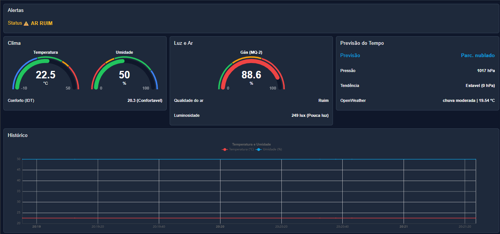
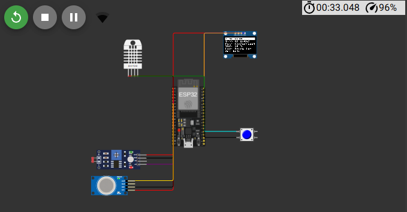
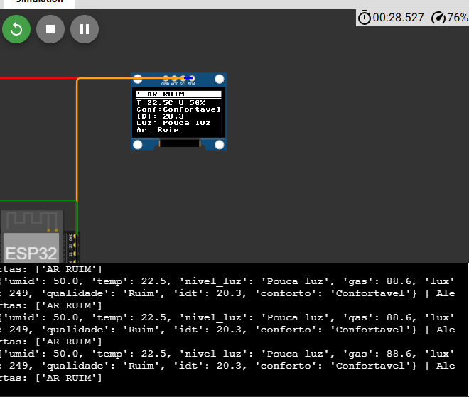
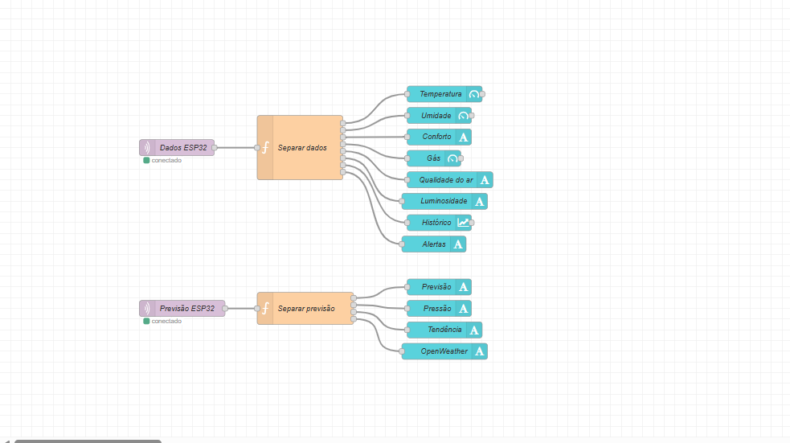
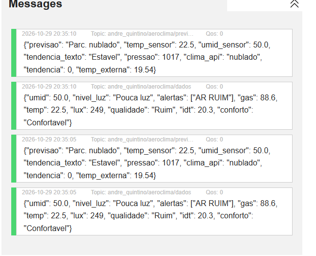

# AeroClima: Estação Meteorológica Virtual com ESP32

Estação meteorológica simulada no **Wokwi** com ESP32 em **MicroPython**, que mede temperatura, umidade, luminosidade e qualidade do ar, calcula o conforto térmico, gera alertas, faz uma previsão do tempo com base na pressão atmosférica da **OpenWeatherMap** e envia tudo via **MQTT (HiveMQ)** para uma dashboard em tempo real no **Node-RED**.

🔗 **Simulação no Wokwi:** https://wokwi.com/projects/479254361197393921

## Demonstração

### Dashboard em tempo real (Node-RED)


### Circuito no Wokwi


### Display OLED com alerta ativo


### Fluxo no Node-RED


### Mensagens chegando no HiveMQ


## Funcionalidades

- Leitura de temperatura e umidade (DHT22), luminosidade em lux (LDR) e qualidade do ar (MQ-2)
- Cálculo do conforto térmico pelo **Índice de Desconforto de Thom (IDT)**
- Alertas visuais piscando no display para condições extremas (temperatura alta/baixa, umidade baixa, calor perigoso, ar ruim)
- 5 telas no display OLED, alternadas pelo botão: Geral, Clima, Luz, Ar e Previsão
- Consulta da pressão atmosférica real na OpenWeatherMap a cada 60 segundos
- Previsão do tempo combinando pressão, tendência da pressão e os dados do sensor local
- Envio dos dados e da previsão para o HiveMQ a cada 5 segundos
- Dashboard no Node-RED (Dashboard 2.0) com gauges, indicadores e gráfico histórico

## Componentes e ligações

| Componente | Pino ESP32 | Tipo |
|---|---|---|
| Display OLED SSD1306 | SDA 21 / SCL 22 | I2C |
| DHT22 | GPIO 15 | Digital |
| LDR (fotoresistor) | GPIO 34 | Analógico (ADC1) |
| MQ-2 (gás) | GPIO 35 | Analógico (ADC1) |
| Botão | GPIO 4 (pull-up interno) | Digital (interrupção) |

Os sensores analógicos usam o ADC1 (pinos 34 e 35) porque o ADC2 fica indisponível com o Wi-Fi ativo.

## Arquitetura

```
ESP32 (Wokwi) ──MQTT──> HiveMQ ──MQTT──> Node-RED ──> Dashboard
      │
      └──HTTP──> OpenWeatherMap (pressão atmosférica)
```

### Tópicos MQTT

| Tópico | Conteúdo |
|---|---|
| `andre_quintino/aeroclima/dados` | Leituras dos sensores, conforto térmico e alertas |
| `andre_quintino/aeroclima/previsao` | Previsão do tempo, pressão e tendência |

Exemplo de mensagem em `dados`:

```json
{"temp": 22.5, "umid": 50.0, "lux": 249, "nivel_luz": "Pouca luz",
 "gas": 88.6, "qualidade": "Ruim", "idt": 20.3, "conforto": "Confortavel",
 "alertas": ["AR RUIM"]}
```

## Conforto térmico (Índice de Thom)

```
IDT = T - (0,55 - 0,0055 × UR) × (T - 14,5)
```

| IDT | Classificação |
|---|---|
| < 15 | Frio |
| 15 a 21 | Confortável |
| 21 a 24 | Leve desconforto |
| 24 a 27 | Desconforto |
| 27 a 29 | Muito desconforto |
| ≥ 29 | Perigo |

## Previsão do tempo

A pressão vem da OpenWeatherMap e as últimas 10 leituras formam a tendência (caindo, estável ou subindo). A previsão cruza esses valores com a temperatura e a umidade do DHT22:

| Condição | Previsão |
|---|---|
| Temp ≥ 30 °C, umidade ≥ 70% e pressão < 1012 hPa ou caindo | Tempestade |
| Pressão caindo ≥ 1 hPa, ou < 1005 hPa com umidade ≥ 80% | Chuva |
| Pressão < 1010 hPa ou umidade ≥ 80% | Nublado |
| Pressão ≥ 1018 hPa e umidade < 65% | Ensolarado (ou Céu limpo abaixo de 18 °C) |
| Demais casos | Parcialmente nublado |

## Estrutura do repositório

```
aeroclima-esp32/
├── imagens/             # prints da demonstração
├── wokwi/
│   ├── main.py          # código principal
│   ├── ssd1306.py       # driver do display OLED
│   └── diagram.json     # circuito do Wokwi
└── node-red/
    └── dashboard-aeroclima.json   # fluxo da dashboard
```

## Como executar

### Wokwi

1. Crie um projeto ESP32 MicroPython no [Wokwi](https://wokwi.com)
2. Copie os três arquivos da pasta `wokwi/`
3. Gere uma chave gratuita na [OpenWeatherMap](https://home.openweathermap.org/api_keys) e coloque em `OWM_CHAVE`
4. Para testar sem a API, defina `PRESSAO_TESTE` com um valor em hPa (ex: `1000`)
5. Inicie a simulação

### Node-RED

1. Instale o Node-RED e o módulo `@flowfuse/node-red-dashboard` (Dashboard 2.0)
2. Menu → **Importar** → selecione `node-red/dashboard-aeroclima.json`
3. Clique em **Implementar (Deploy)**
4. Acesse `http://127.0.0.1:1880/dashboard/aeroclima`

## Tecnologias

ESP32 · MicroPython · Wokwi · MQTT · HiveMQ · OpenWeatherMap API · Node-RED · Dashboard 2.0

## Autor

**André Quintino**, estudante de Engenharia de Software na UMC
[GitHub](https://github.com/andredx12) · [LinkedIn](https://linkedin.com/in/andre-quintino-dev)
